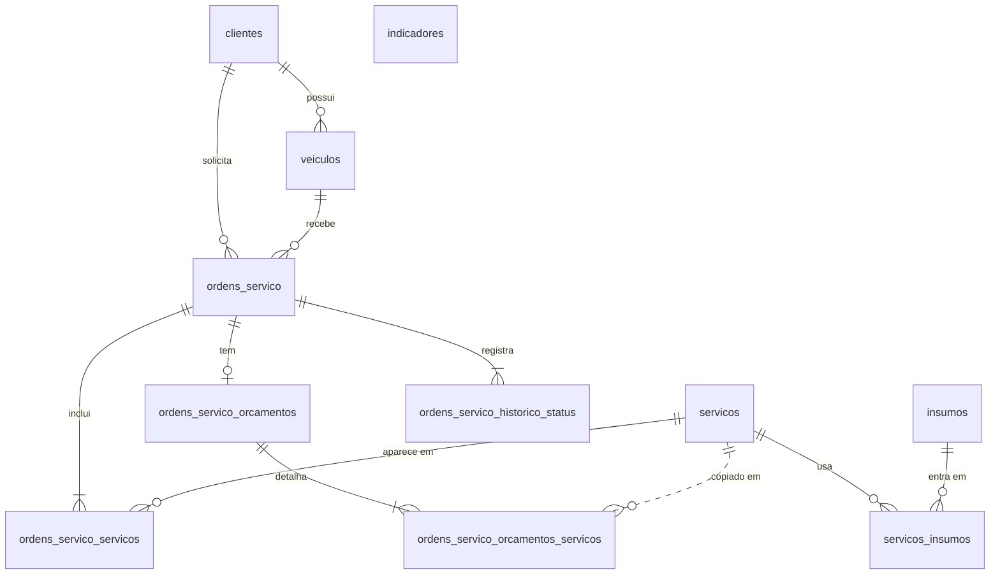

# ADR-017: PostgreSQL no Amazon RDS e Modelo de Dados

**Status**: Aceita

**Resumo**:
O banco do sistema é o PostgreSQL, gerenciado pelo Amazon RDS. Esta ADR registra a justificativa formal da escolha e documenta o modelo de dados: o diagrama ER (entidade-relacionamento) e a explicação de cada relacionamento, na seção [Modelo de dados](#modelo-de-dados). As opções comparadas estão na [RFC-002](../rfc/RFC-002-Escolha-do-Banco-de-Dados.md).

> As ADRs são numeradas em sequência única entre os quatro repositórios do projeto. O índice de todas as decisões está no [docs/arquitetura.md](https://github.com/GuiToniello/tech-challenge-fase-3-APP-soat16-rm374658/blob/main/docs/arquitetura.md#5-decisões-de-arquitetura-rfcs-e-adrs) do repo APP.

**Contexto**:
- O sistema guarda clientes, veículos, serviços, peças (insumos), ordens de serviço (OS), orçamentos e o histórico de status de cada OS.
- As 5 APIs leem e gravam no mesmo banco ([ADR-015](https://github.com/GuiToniello/tech-challenge-fase-3-APP-soat16-rm374658/blob/main/docs/adr/ADR-015-Comunicacao-Sincrona-via-API-Gateway.md)), e a Lambda buscar-cliente consulta a tabela `clientes`.
- Este repositório cria só a instância e o banco vazio `oficina`. As tabelas são criadas pelas migrations do Entity Framework Core, no repositório APP, quando as APIs sobem (ADR-007 e ADR-009).
- As opções avaliadas (Aurora, MySQL, SQL Server, DynamoDB, MongoDB e PostgreSQL dentro do EKS) estão na RFC-002.

**Decisão**:
Usar um banco relacional **PostgreSQL no Amazon RDS**, com a configuração da [seção 1 do README](../../README.md#1-o-que-é-provisionado) e o modelo de dados descrito na seção [Modelo de dados](#modelo-de-dados).

**Justificativa formal**:

| Critério | Como o PostgreSQL no RDS atende | Evidência no projeto |
|---|---|---|
| Integridade dos relacionamentos | Chaves estrangeiras impedem apontar para um registro que não existe e definem o que acontece numa exclusão | 10 chaves estrangeiras entre as 11 tabelas |
| Valores únicos | Índices únicos, garantidos pelo banco mesmo com várias APIs gravando ao mesmo tempo | `clientes.identificacao` (CPF/CNPJ) e `veiculos.placa` |
| Transações (ACID) | Cada gravação é "tudo ou nada" | A OS é gravada junto com os seus serviços e o histórico de status |
| Consultas | SQL com filtros, junções e índices | Listas de OS por status e por cliente, e o cálculo dos indicadores |
| Tipos de dados | Tipos nativos para os dados do modelo | `uuid` (identificadores), `interval` (tempos médios), `timestamp with time zone` (datas) e `numeric(18,2)` (valores) |
| Ecossistema .NET | Provider Npgsql maduro no Entity Framework Core | ADR-007 e ADR-009; a Lambda buscar-cliente também usa o Npgsql |
| Mesmo banco local e na nuvem | O mesmo motor nos dois ambientes | `postgres:17-alpine` no `docker-compose.yml` do APP e RDS for PostgreSQL na AWS |
| Operação gerenciada | A AWS cuida da instalação, das atualizações e do disco criptografado | `aws_db_instance` com `storage_encrypted = true` ([rds.tf](../../infra/rds.tf)) |
| Segurança de rede | Sem acesso pela internet; só os nós do EKS e a Lambda buscar-cliente conectam | `publicly_accessible = false`, sub-redes privadas e o SG `techchallenge-oficina-rds-sg` |
| Custo | Código aberto, sem licença; uma instância pequena basta | `db.t3.micro` com 20 GiB `gp3` |

**Consequências**:
- ✅ Os dados ficam consistentes mesmo com 5 APIs gravando ao mesmo tempo: o banco recusa duplicatas e referências quebradas.
- ✅ O mesmo banco roda na máquina de quem desenvolve e na AWS, então o que funciona localmente funciona na nuvem.
- ✅ Não há servidor de banco para administrar.
- ⚠ Uma zona só, sem backup e sem proteção contra exclusão: um Destroy apaga todos os dados. Aceito por ser um ambiente de estudo.
- ⚠ Banco único para as 5 APIs: uma mudança nas tabelas afeta todas (ADR-015).
- ⚠ A versão do PostgreSQL não está fixada no Terraform: o RDS usa a versão padrão da AWS no momento da criação, enquanto o ambiente local usa a 17.
- ⚠ Algumas operações gravam em etapas separadas, sem uma transação única, como a abertura completa da OS e o débito de estoque (ADR-012 e ADR-014). É uma limitação do código, não do banco, que oferece transações.

**Alternativas Rejeitadas** (comparação completa na RFC-002):
- Amazon Aurora PostgreSQL:
  - rejeitada por ser maior e mais complexa do que o projeto precisa.
- MySQL ou SQL Server no RDS:
  - rejeitadas por exigirem refazer as migrations e o ambiente local; o SQL Server também tem licença paga.
- DynamoDB ou MongoDB:
  - rejeitadas porque não garantem relacionamentos no banco, e o modelo da oficina é cheio deles.
- PostgreSQL num pod do EKS:
  - rejeitada porque backup, atualização e disco ficariam por conta do time, ocupando um cluster que já está perto do limite.

**Relação com Outras ADRs**:
- **ADR-007** (repo APP): acesso aos dados com Entity Framework Core e Npgsql: [ADR-007](https://github.com/GuiToniello/tech-challenge-fase-3-APP-soat16-rm374658/blob/main/docs/adr/ADR-007-EFCore-com-PostgreSQL.md).
- **ADR-009** (repo APP): as tabelas são criadas pelas migrations, no startup das APIs: [ADR-009](https://github.com/GuiToniello/tech-challenge-fase-3-APP-soat16-rm374658/blob/main/docs/adr/ADR-009-Migracoes-Automaticas-no-Startup.md).
- **ADR-012** (repo APP): controle de estoque na tabela `insumos`: [ADR-012](https://github.com/GuiToniello/tech-challenge-fase-3-APP-soat16-rm374658/blob/main/docs/adr/ADR-012-Controle-de-Estoque-de-Insumos.md).
- **ADR-015** (repo APP): as 5 APIs compartilham este banco.

## Modelo de dados

### 1. Diagrama ER (visão geral)

Cada caixa é uma tabela, e cada linha liga duas tabelas. Os símbolos nas pontas das linhas dizem quantos registros de um lado se ligam ao outro:

| Na ponta da linha | Significa |
|---|---|
| Dois traços | Exatamente um |
| Círculo e traço | Zero ou um |
| Traço e "pé de galinha" (três riscos) | Um ou mais |
| Círculo e "pé de galinha" | Zero ou mais |

A linha cheia é uma chave estrangeira no banco. A linha tracejada é uma referência guardada sem chave estrangeira.

### 2. Explicação dos relacionamentos

| Relacionamento | Tipo | Em palavras simples | Ao excluir |
|---|---|---|---|
| `clientes` → `veiculos` | 1 para N | Um cliente pode ter vários veículos, e cada veículo tem um dono (`veiculos.cliente_id`) | O banco não deixa excluir um cliente que tem veículos (`RESTRICT`) |
| `clientes` → `ordens_servico` | 1 para N | Um cliente pode ter várias OS, e cada OS é de um cliente | Não deixa excluir um cliente que tem OS (`RESTRICT`) |
| `veiculos` → `ordens_servico` | 1 para N | Um veículo pode passar por várias OS, e cada OS é de um veículo. O código também confere que o veículo é do cliente da OS | Não deixa excluir um veículo que tem OS (`RESTRICT`) |
| `ordens_servico` ↔ `servicos`, pela tabela `ordens_servico_servicos` | N para N | Uma OS tem um ou mais serviços, e um serviço pode estar em várias OS. A tabela do meio guarda os pares (OS, serviço) | Excluir a OS apaga os pares dela (`CASCADE`). Um serviço usado em alguma OS não pode ser excluído (`RESTRICT`) |
| `servicos` ↔ `insumos`, pela tabela `servicos_insumos` | N para N, com dado extra | Um serviço usa várias peças, cada uma com uma quantidade, e uma peça pode ser usada em vários serviços | Excluir o serviço apaga a lista de peças dele (`CASCADE`). Uma peça usada em algum serviço não pode ser excluída (`RESTRICT`) |
| `ordens_servico` → `ordens_servico_historico_status` | 1 para N | Cada mudança de status vira uma linha, com data e hora. Toda OS tem pelo menos a linha `Recebida` | Excluir a OS apaga o histórico dela (`CASCADE`) |
| `ordens_servico` → `ordens_servico_orcamentos` | 1 para 0 ou 1 | A OS tem no máximo um orçamento, gerado depois da abertura. O orçamento usa a mesma chave da OS (`ordem_servico_id`) | Excluir a OS apaga o orçamento (`CASCADE`) |
| `ordens_servico_orcamentos` → `ordens_servico_orcamentos_servicos` | 1 para N | Cada linha é um serviço do orçamento, com o nome e o valor copiados no momento em que o orçamento foi gerado | Excluir o orçamento apaga as linhas dele (`CASCADE`) |
| `servicos` ⇢ `ordens_servico_orcamentos_servicos` | Referência sem chave estrangeira | O `servico_id` fica guardado só para consulta. Como o nome e o valor também são copiados, mudar o preço de uma peça depois não altera um orçamento já gerado | Sem regra no banco |
| `indicadores` | Tabela isolada | Uma única linha (`id = 1`) com os tempos médios de execução e de entrega das OS. É recalculada sempre que uma OS é entregue, a partir do histórico de status | Não se aplica |

### 3. Tabelas e colunas

| Tabela | O que guarda | Colunas |
|---|---|---|
| `clientes` | Clientes da oficina | `Id` (chave), `nome_completo`, `identificacao` (CPF ou CNPJ, só números, único), `tipo_identificacao` (1 = CPF, 2 = CNPJ) e `email` (opcional) |
| `veiculos` | Veículos dos clientes | `Id` (chave), `placa` (padrão Mercosul, única), `marca`, `modelo`, `ano`, `renavam` e `cliente_id` |
| `servicos` | Catálogo de serviços | `Id` (chave), `nome` e `descricao` |
| `insumos` | Peças e materiais, com o estoque | `Id` (chave), `nome`, `fabricante`, `quantidade_disponivel` (estoque) e `valor_unitario` |
| `servicos_insumos` | Peças que cada serviço usa | `servico_id` e `insumo_id` (chave composta) e `quantidade` |
| `ordens_servico` | Ordens de serviço | `Id` (chave), `cliente_id`, `veiculo_id` e `status` (tabela abaixo) |
| `ordens_servico_servicos` | Serviços de cada OS | `ordem_servico_id` e `servico_id` (chave composta) |
| `ordens_servico_historico_status` | Cada mudança de status de uma OS | `id` (número gerado pelo banco), `ordem_servico_id`, `status` e `data_alteracao` |
| `ordens_servico_orcamentos` | Orçamento de uma OS | `ordem_servico_id` (chave, a mesma da OS), `data_geracao` e `valor_total` |
| `ordens_servico_orcamentos_servicos` | Serviços do orçamento, com nome e valor copiados | `id` (número gerado pelo banco), `ordem_servico_id`, `servico_id`, `nome_servico` e `valor_total` |
| `indicadores` | Tempos médios das OS entregues | `id` (sempre 1), `tempo_medio_execucao` e `tempo_medio_entrega` |

Valores da coluna `status` (em `ordens_servico` e no histórico):

| Valor | Status |
|---|---|
| 1 | Recebida |
| 2 | Em diagnóstico |
| 3 | Aguardando aprovação |
| 4 | Em execução |
| 5 | Finalizada |
| 6 | Entregue |
| 7 | Encerrada (prevista, mas nenhum fluxo usa) |

Observações:
- As chaves das tabelas principais se chamam `Id`, com "I" maiúsculo (padrão do Entity Framework Core). Numa consulta SQL feita à mão, use aspas: `SELECT "Id" FROM clientes`.
- O Entity Framework Core também cria a tabela `__EFMigrationsHistory`, que registra quais migrations já foram aplicadas.

### 4. Regras de integridade

Garantidas pelo banco:
- chave primária em todas as tabelas;
- as 10 chaves estrangeiras da seção 2, com `RESTRICT` (impede a exclusão) ou `CASCADE` (exclui junto);
- valores únicos: `clientes.identificacao` e `veiculos.placa`;
- índices para as consultas mais comuns, como `status`, `cliente_id` e `veiculo_id` em `ordens_servico`, e `ordem_servico_id` e `data_alteracao` no histórico.

Garantidas pelo código das APIs (regras de negócio):
- toda OS tem pelo menos um serviço, e o veículo da OS é do cliente da OS;
- o status só muda na ordem permitida (por exemplo, só uma OS `Finalizada` pode ser `Entregue`);
- CPF e CNPJ com dígitos verificadores válidos, placa no padrão Mercosul e ano entre 1886 e o ano seguinte ao atual;
- quantidade de peça maior que zero, e estoque e valores nunca negativos.

### 5. Como manter este modelo atualizado

- A fonte da verdade são as [migrations](https://github.com/GuiToniello/tech-challenge-fase-3-APP-soat16-rm374658/tree/main/server/1%20-%20Frameworks%20%26%20Drivers/TechChallenge.Oficina.DB/Migrations) e as [configurações do Entity Framework Core](https://github.com/GuiToniello/tech-challenge-fase-3-APP-soat16-rm374658/tree/main/server/1%20-%20Frameworks%20%26%20Drivers/TechChallenge.Oficina.DB/Features), no repo APP.
- Ao criar uma migration nova, atualize o diagrama e as tabelas desta ADR.
- O modelo de domínio (as classes do código) está no [domain-model.puml](https://github.com/GuiToniello/tech-challenge-fase-3-APP-soat16-rm374658/blob/main/docs/diagram/domain-model.puml) do repo APP.
